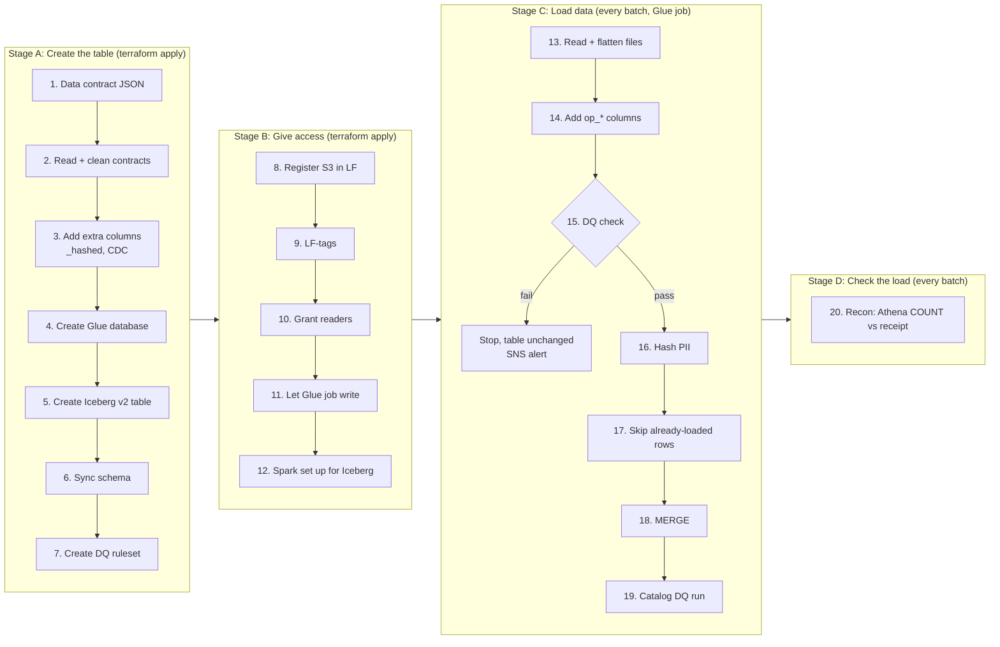

# Lake Formation + Iceberg: architecture

How one data contract becomes an Iceberg table that is access-controlled by Lake Formation, loaded every batch, and checked.

**Already in place:** GitHub → AWS login with OIDC (`github-terraform` role), state bucket per env, manual GHA workflow (plan → apply/destroy), Glue database `lf_learn_<env>`.

---

## Stage A: Create the table (terraform apply)

| # | Step | Note |
|---|---|---|
| 1 | Write the data contract | One JSON file per table in `data-contracts/`: table name, columns, types, key columns, PII tags, CDC type, DQ rules. Everything after this is generated from it. |
| 2 | Read and clean the contracts | `locals.tf`: `fileset()` + `jsondecode()`. Make names safe for Glue/Athena: lower case, `_` instead of `-`. |
| 3 | Add extra columns | Columns the source doesn't have but the load writes: `<col>_hashed` for each PII column, plus CDC/history columns. The table must already have them, or the write fails. |
| 4 | Create the Glue database | A container for the tables. Its `location_uri` is the S3 root folder every table lives under, in the processed bucket. |
| 5 | Create the Iceberg table | Terraform registers an empty Iceberg v2 table in Glue with its own S3 folder. Glue writes the first `metadata.json`; the Iceberg schema may still be empty. |
| 6 | Sync the schema | Athena DDL (`ALTER TABLE ... ADD COLUMNS` / `DROP COLUMN` / `CHANGE COLUMN`) makes the Iceberg schema match the contract: all columns on the first run, then only the changes. Run from Terraform after step 5 (at work: `athena_ddl.py`). |
| 7 | Create the DQ ruleset | Store the contract's quality rules (`row_count`, `not_null`, `unique`, …) as a Glue Data Quality ruleset, so the load and the console can check the table. |

## Stage B: Give access (terraform apply)

| # | Step | Note |
|---|---|---|
| 8 | Register the S3 folder in Lake Formation | Hands control of the table folder to LF, so access is managed by LF grants instead of bucket policies. Path must match the database root from step 4. |
| 9 | Tag the table and columns | LF-tags such as `pii = true/false`, so each reader only sees what their tags allow. Values come from the contract. |
| 10 | Grant readers | Analysts get `DESCRIBE` on the database and tag-based `SELECT` (non-PII only). Service roles can get `SELECT` on all tables. |
| 11 | Let the Glue job write | The job's role needs LF `ALTER`, `INSERT`, `SELECT` on the table, plus `lakeformation:GetDataAccess` in IAM. Without these it can't commit a new version. |
| 12 | Set up Spark for Iceberg | Glue 5.0 job with `--datalake-formats=iceberg`. Tells Spark that `glue_catalog.<db>.<table>` is an Iceberg table in S3, tracked in Glue. |

## Stage C: Load data (every batch, Glue job)

| # | Step | Note |
|---|---|---|
| 13 | Read and flatten the files | Source JSON is nested (e.g. `conversations[]`). The table needs one row per item, so explode the array. |
| 14 | Add batch columns | Stamp every row with `op_*` columns: batch ID, run time, source file. Lets you trace and count each batch. |
| 15 | Check data quality | Run the step 7 rules on the batch. **Fail → stop, table unchanged, SNS alert.** Pass → continue. |
| 16 | Hash PII | Fill `<col>_hashed` (e.g. SHA-256) so PII can be joined or counted without exposing the value. |
| 17 | Skip already-loaded rows | Drop rows older than what's already in the table, using the contract's `updated_on` column. Stops re-loading old data. |
| 18 | MERGE into the table | Upsert by key columns. Iceberg writes new Parquet + a new `metadata.json`, then Glue's pointer moves to it. One writer at a time. |
| 19 | Run catalog DQ | Run the ruleset on the whole table and record results in the Glue console. Doesn't block the batch. |

## Stage D: Check the load (every batch)

| # | Step | Note |
|---|---|---|
| 20 | Count the batch | A recon Lambda runs Athena `COUNT(*)` per `op_*` batch ID and compares it with the receipt (rows sent). A mismatch fails the batch. Needs LF `SELECT` on the table. |

---

## Suggested order for this project
1. Steps 1–5: contract → table exists in Glue/Athena.
2. Steps 8–10: Lake Formation access, see PII hidden for an analyst.
3. Step 18 with Athena `MERGE` (no Glue job yet), then step 20 as a manual Athena count.
4. Then the Glue job path (11–17, 19), DQ (7, 15) and schema sync (6).

**Known gaps (same as work):** old versions are never cleaned up, because there's no compaction or snapshot expiry.
