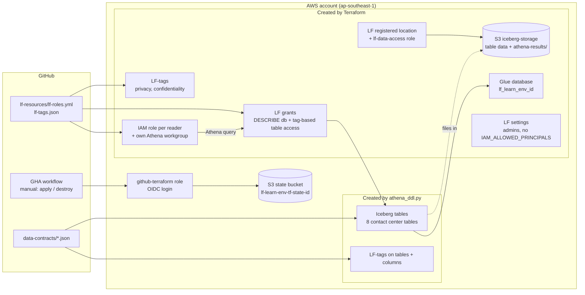
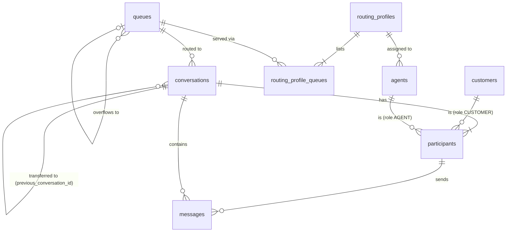

# Lake Formation + Iceberg learning project

This project turns data contracts (JSON files) into Iceberg tables in the Glue Data Catalog. AWS Lake Formation (LF) then decides which IAM role can see which tables and columns, using LF-tags. Everything is deployed by one GitHub Actions workflow. Nothing is applied from a laptop.

- [Current architecture](#current-architecture)
- [Repo layout](#repo-layout)
- [Deploy flow](#deploy-flow)
- [Access model](#access-model)
- [Data model: chat contact center](#data-model-chat-contact-center)
- [Not built yet](#not-built-yet)

---

## Current architecture



| Piece | File | What it does |
|---|---|---|
| Backend + provider | [terraform/common.tf](terraform/common.tf) | State is stored in S3 with a lock file (`use_lockfile`). Each resource name starts with `lf-learn-<env>-<account_id>`. Default tags are added. |
| Storage | [terraform/s3.tf](terraform/s3.tf) | One private bucket, `...-iceberg-storage`. It holds the Iceberg data and metadata under `<dataset>/<table>/`, plus Athena results under `athena-results/<role>/`. |
| Catalog | [terraform/glue-database.tf](terraform/glue-database.tf) | One Glue database, `lf_learn_<env>_<account_id>`. The name uses `_` because Glue doesn't allow `-`. |
| LF settings | [terraform/lf-default-settings.tf](terraform/lf-default-settings.tf) | LF admins are `github-terraform` and the console user. There are no default `IAM_ALLOWED_PRINCIPALS` grants, so LF controls every new table. The bucket is registered in LF with our own `lf-data-access` role. The service-linked role would block `destroy`. |
| LF-tags | [terraform/lf-tags.tf](terraform/lf-tags.tf) | Creates the tag keys and values listed in `lf-tags.json`. |
| Reader roles | [terraform/lf-iam-roles.tf](terraform/lf-iam-roles.tf) | Creates one IAM role per entry in `lf-roles.yml`. A role can use Athena only in its own workgroup, read Glue metadata, and call `lakeformation:GetDataAccess`. It has no direct S3 read on table data. |
| Workgroups | [terraform/athena.tf](terraform/athena.tf) | Creates one Athena workgroup per role, with its own results folder and query history. |
| LF grants | [terraform/lf-permissions.tf](terraform/lf-permissions.tf) | Each role gets `DESCRIBE` on the database by name. Table permissions are granted with an LF-tag expression: tag keys are ANDed, and the values within a key are ORed. |
| Tables | [scripts/athena_ddl.py](scripts/athena_ddl.py) | Reads each contract. It runs `CREATE TABLE ... TBLPROPERTIES ('table_type'='ICEBERG')` the first time. On later runs it runs `ALTER TABLE ADD / CHANGE / DROP COLUMN` so the table matches the contract. Then it puts the contract's LF-tags on the table and on each column. |

## Repo layout

```
.github/workflows/terraform.yml   manual workflow: plan -> apply -> athena_ddl  |  plan -> destroy
data-contracts/*.json             one file per table: columns, types, keys, partitions, LF-tags, CDC type
envs/common.tfvars, dev, prod     project_name, region, environment
lf-resources/lf-roles.yml         reader roles: who can assume them, LF permissions, tag expression
lf-resources/lf-tags.json         tag keys + allowed values
scripts/athena_ddl.py             contract -> Iceberg table DDL + LF-tags
terraform/                        everything else (see table above)
```

## Deploy flow

The workflow is started by hand (`workflow_dispatch`). You pick an environment (`dev` / `prod`) and an action (`apply` / `destroy`).

1. **get_account_id**: reads the account ID from the environment choice, then builds the role ARN and the state bucket name.
2. **oidc**: checks that GitHub can assume `github-terraform`.
3. **plan**: runs `terraform plan`, or `plan -destroy` for a destroy.
4. **apply**: runs `terraform apply`. Its outputs (database name, bucket) are passed to the next job as JSON.
5. **athena_ddl**: runs `athena_ddl.py <database> <bucket>`, which creates or alters the tables and tags them.
6. **destroy**: used instead of 4 and 5. Runs `terraform destroy`.

Tables are created by the script, not by Terraform, so Terraform doesn't track them in its state. Because the bucket has `force_destroy` set, `destroy` also deletes their files.

## Access model

Every table and every column carries two LF-tags:

| Tag | Values | Meaning |
|---|---|---|
| `privacy` | `non-PII`, `PII` | Does it identify a person (name, phone, email, address, free text)? |
| `confidentiality` | `internal`, `confidential` | Is it business-sensitive (costs, rates, commission)? |

What each role in `lf-roles.yml` can see:

| Role | LF permissions | privacy | confidentiality |
|---|---|---|---|
| `glue-worker` | SELECT, INSERT, DELETE, ALTER, DESCRIBE | non-PII, PII | internal, confidential |
| `admin` | SELECT, DESCRIBE | non-PII, PII | internal, confidential |
| `customer-service` | SELECT, DESCRIBE | non-PII, PII | internal |
| `general-users` | SELECT, DESCRIBE | non-PII | internal |

Columns that don't match a role's tags are left out of that role's query results. For example, `general-users` running `SELECT *` gets every column except the PII ones.

---

## Data model: chat contact center

A transfer works the same way as in Connect: it creates a **new** conversation row that points back through `previous_conversation_id`. All rows from one chat share the same `initial_conversation_id`.



**8 tables in 3 groups:**
- Reference data: `queues`, `routing_profiles`, `routing_profile_queues`
- People: `customers`, `agents`
- Events: `conversations`, `participants`, `messages`

Every table has an `updated_on` column. The planned CDC "skip already-loaded rows" step uses it.

### How a chat flows (overview)

1. **The customer starts a chat**: *"I paid 500k but the shop didn't receive it"*.
   This adds a row to `conversations` (status `QUEUED`), the customer to `participants` (role `CUSTOMER`), and the text to `messages`. The customer is looked up in `customers`, or created there if they're new.

2. **A contact flow puts the chat in a queue**, here *Failed Transaction*. A contact flow is Connect's routing logic. It picks the queue in one of three ways:
   - **Customer's choice (fixed):** a menu button ("Card fraud / Failed transaction / Other"), or the page where the chat started. Each option always goes to the same queue.
   - **Rules:** a regex on the first message, e.g. `/paid|not received|transfer failed/i` → Failed Transaction, `/stolen|didn't make this payment/i` → Card Fraud.
   - **AI:** a bot (Lex or an LLM) detects the intent (`failed_transaction`), and the flow maps the intent to a queue.

   The flow can also use customer data: a `vip` customer gets a higher `conversations.priority`. A closed or full queue sends the chat to its `overflow_queue_id` instead.
   This sets `conversations.queue_id` and `enqueued_at`, which starts the SLA clock.

3. **The queue sets the SLA.** Each queue has its own target for the first reply (`sla_first_response_seconds`). Urgent topics get shorter targets.

4. **Routing profiles handle queues; agents don't.** A routing profile is a group of agents who work the same way, and each agent has exactly one (`agents.routing_profile_id`). `routing_profile_queues` lists which queues each profile takes:
   - `priority`: which queue the team serves first.
   - `delay_seconds`: how long a chat must wait before this team is offered it.

   This lets one queue have a **main team** (no delay) and a **backup team** (after a delay). It also lets one team cover several queues.

5. **A free agent gets the chat.** The agent must be *Available* and have a free slot (below their profile's `chat_concurrency`). Connect checks the agent's queues in `priority` order. Within a queue, the chat with the highest priority goes first, then the one waiting longest. If several agents are free, the one idle longest gets it.
   The agent is added to `participants` (role `AGENT`), and their replies go into `messages`. The SLA is met if `first_agent_response_at - enqueued_at` ≤ the queue's SLA.

6. **Transfer (optional).** The agent can move the chat to another queue. This ends the current conversation (`disconnect_reason = TRANSFERRED`) and starts a new row with `previous_conversation_id` pointing back and the same `initial_conversation_id`. Steps 3–5 then repeat for the new queue.

7. **The chat ends.** `disconnected_at`, `disconnect_reason` and the survey score (`csat_score`) are filled in.

#### Example

**`queues`**

| queue_id | queue_name | sla_first_response_seconds | priority | overflow_queue_id |
|---|---|---|---|---|
| q-01 | Card Fraud | 600 (10 min) | 1 | |
| q-02 | Failed Transaction | 300 (5 min) | 2 | q-03 |
| q-03 | General Enquiry | 1800 (30 min) | 3 | |

**`routing_profiles`** and **`agents`**

| routing_profile_id | routing_profile_name | chat_concurrency | Agents |
|---|---|---|---|
| rp-01 | Payments Team | 3 | Linh |
| rp-02 | Fraud Team | 2 | Minh |

**`routing_profile_queues`**

| routing_profile_id | queue_id | priority | delay_seconds | Meaning |
|---|---|---|---|---|
| rp-01 (Payments Team) | q-02 (Failed Transaction) | 1 | 0 | Main team for failed transactions |
| rp-01 (Payments Team) | q-03 (General Enquiry) | 2 | 0 | Takes general enquiries when there are no failed transactions |
| rp-02 (Fraud Team) | q-01 (Card Fraud) | 1 | 0 | Only team for fraud |
| rp-02 (Fraud Team) | q-02 (Failed Transaction) | 2 | 120 | Backup if a chat waits over 2 min |

**`conversations`**

| conversation_id | initial_conversation_id | previous_conversation_id | queue_id | enqueued_at | first_agent_response_at | disconnect_reason |
|---|---|---|---|---|---|---|
| conv-A | conv-A | | q-02 (Failed Transaction) | 09:00:00 | 09:01:30 | TRANSFERRED |
| conv-B | conv-A | conv-A | q-01 (Card Fraud) | 09:04:00 | 09:06:00 | CUSTOMER_DISCONNECT |

**`participants`**: the only link from a conversation to the customer and the agents.

| participant_id | conversation_id | participant_role | customer_id | agent_id |
|---|---|---|---|---|
| p-1 | conv-A | CUSTOMER | c-1001 (An) | |
| p-2 | conv-A | AGENT | | a-01 (Linh) |
| p-3 | conv-B | CUSTOMER | c-1001 (An) | |
| p-4 | conv-B | AGENT | | a-02 (Minh) |

**What happened:**
- The regex matched *"paid … didn't receive"*, so the chat went to **Failed Transaction**.
- Linh (Payments Team, no delay) was free and replied after 1.5 min, within the 5 min SLA. The Fraud Team would only have been offered the chat after 2 min.
- Linh saw payments the customer didn't recognise and transferred the chat to **Card Fraud**. That created conv-B.
- Only the Fraud Team serves Card Fraud, so Minh got it and replied after 2 min, within the 10 min SLA.
- `GROUP BY initial_conversation_id` shows conv-A and conv-B as one customer chat.

Names in brackets come from a join; only the IDs are stored.

### 1. `queues`
One row per queue that chats wait in.

| Column | Type | Key | Tags (privacy / confidentiality) | Notes |
|---|---|---|---|---|
| queue_id | string | PK | non-PII / internal | Connect queue ID |
| queue_name | string | | non-PII / internal | e.g. `Failed Transaction` |
| category | string | | non-PII / internal | `card_fraud`, `failed_transaction`, `general_enquiry` |
| language | string | | non-PII / internal | ISO code, e.g. `vi`, `en` |
| priority | int | | non-PII / internal | 1 = highest. The default priority for chats entering this queue |
| sla_first_response_seconds | int | | non-PII / internal | Target time from enqueue to the first agent message |
| sla_resolution_seconds | int | | non-PII / internal | Target time from enqueue to disconnect |
| max_concurrent_chats | int | | non-PII / internal | Upper limit of chats waiting in the queue |
| overflow_queue_id | string | FK → queues | non-PII / internal | Where chats go when the queue is full |
| hours_of_operation | string | | non-PII / internal | e.g. `MON-FRI 08:00-20:00 Asia/Ho_Chi_Minh` |
| is_active | boolean | | non-PII / internal | |
| updated_on | timestamp | | non-PII / internal | CDC column |

### 2. `routing_profiles`
One row per routing profile. A profile decides which queues an agent takes chats from, and how many at once.

| Column | Type | Key | Tags | Notes |
|---|---|---|---|---|
| routing_profile_id | string | PK | non-PII / internal | |
| routing_profile_name | string | | non-PII / internal | e.g. `Payments Team` |
| chat_concurrency | int | | non-PII / internal | Number of chats an agent can handle at the same time (Connect allows 1–10) |
| default_outbound_queue_id | string | FK → queues | non-PII / internal | |
| updated_on | timestamp | | non-PII / internal | |

### 3. `routing_profile_queues`
A bridge table (many-to-many): which queues a profile serves, and in what order.

| Column | Type | Key | Tags | Notes |
|---|---|---|---|---|
| routing_profile_id | string | PK, FK → routing_profiles | non-PII / internal | |
| queue_id | string | PK, FK → queues | non-PII / internal | |
| priority | int | | non-PII / internal | Agents on this profile take chats from lower numbers first |
| delay_seconds | int | | non-PII / internal | How long a chat waits before agents on this profile are offered it (tiered routing) |
| updated_on | timestamp | | non-PII / internal | |

### 4. `customers`
One row per end customer (a Customer Profiles profile).

| Column | Type | Key | Tags | Notes |
|---|---|---|---|---|
| customer_id | string | PK | non-PII / internal | Profile ID |
| full_name | string | | **PII** / internal | |
| email | string | | **PII** / internal | |
| phone_number | string | | **PII** / internal | E.164 format |
| country | string | | non-PII / internal | |
| preferred_language | string | | non-PII / internal | |
| segment | string | | non-PII / internal | `standard`, `vip`, `enterprise` |
| lifetime_value | decimal(12,2) | | non-PII / **confidential** | Business number, hidden from customer-service |
| created_at | timestamp | | non-PII / internal | |
| updated_on | timestamp | | non-PII / internal | |

### 5. `agents`
One row per agent (a Connect user).

| Column | Type | Key | Tags | Notes |
|---|---|---|---|---|
| agent_id | string | PK | non-PII / internal | Connect user ID |
| username | string | | non-PII / internal | Login name |
| full_name | string | | **PII** / internal | |
| email | string | | **PII** / internal | |
| routing_profile_id | string | FK → routing_profiles | non-PII / internal | |
| team | string | | non-PII / internal | Connect hierarchy group, e.g. `HCM / Payments / Team A` |
| supervisor_agent_id | string | FK → agents | non-PII / internal | |
| hourly_cost | decimal(10,2) | | non-PII / **confidential** | Used for cost-per-chat reports |
| hired_at | date | | non-PII / internal | |
| is_active | boolean | | non-PII / internal | |
| updated_on | timestamp | | non-PII / internal | |

### 6. `conversations`
One row per contact. A chat that is transferred has one row for each leg. There's no `customer_id` or `agent_id` here: who was in the chat is stored only in `participants`. That also covers legs with several agents, such as a supervisor joining.

| Column | Type | Key | Tags | Notes |
|---|---|---|---|---|
| conversation_id | string | PK | non-PII / internal | Connect contact ID |
| initial_conversation_id | string | FK → conversations | non-PII / internal | First leg of the chat. Group by this to get the whole customer journey |
| previous_conversation_id | string | FK → conversations | non-PII / internal | Leg it was transferred from. Null on the first leg |
| queue_id | string | FK → queues | non-PII / internal | Queue this leg waited in |
| initiation_method | string | | non-PII / internal | `API` (new chat), `TRANSFER`, `QUEUE_TRANSFER` |
| channel | string | | non-PII / internal | Always `CHAT` for now. Kept so voice/email can be added later |
| priority | int | | non-PII / internal | Priority actually used (can override `queues.priority`) |
| status | string | | non-PII / internal | `QUEUED`, `CONNECTED`, `ENDED` |
| initiated_at | timestamp | | non-PII / internal | **Partition: day** |
| enqueued_at | timestamp | | non-PII / internal | |
| agent_connected_at | timestamp | | non-PII / internal | Queue wait = `agent_connected_at - enqueued_at` |
| first_agent_response_at | timestamp | | non-PII / internal | Checked against `queues.sla_first_response_seconds` |
| disconnected_at | timestamp | | non-PII / internal | |
| disconnect_reason | string | | non-PII / internal | `CUSTOMER_DISCONNECT`, `AGENT_DISCONNECT`, `EXPIRED`, `TRANSFERRED` |
| csat_score | int | | non-PII / internal | 1–5 from the post-chat survey. Null if the customer didn't answer |
| updated_on | timestamp | | non-PII / internal | |

### 7. `participants`
One row per person or bot inside a conversation. There is no single "sender" column on messages, because a sender can be a customer, an agent, a bot or the system. Instead, messages point to a participant, and the participant points to the matching person table.

| Column | Type | Key | Tags | Notes |
|---|---|---|---|---|
| participant_id | string | PK | non-PII / internal | Connect participant ID |
| conversation_id | string | FK → conversations | non-PII / internal | |
| participant_role | string | | non-PII / internal | `CUSTOMER`, `AGENT`, `SUPERVISOR`, `CUSTOM_BOT`, `SYSTEM` |
| customer_id | string | FK → customers | non-PII / internal | Filled only when role = `CUSTOMER` |
| agent_id | string | FK → agents | non-PII / internal | Filled only when role = `AGENT` / `SUPERVISOR` |
| display_name | string | | **PII** / internal | Name shown in the chat window |
| joined_at | timestamp | | non-PII / internal | |
| left_at | timestamp | | non-PII / internal | |
| updated_on | timestamp | | non-PII / internal | |

Rule: exactly one of `customer_id` / `agent_id` is set for human roles. Both are null for `CUSTOM_BOT` and `SYSTEM`.

### 8. `messages`
One row per item in the chat transcript.

| Column | Type | Key | Tags | Notes |
|---|---|---|---|---|
| message_id | string | PK | non-PII / internal | Transcript item ID |
| conversation_id | string | FK → conversations | non-PII / internal | |
| participant_id | string | FK → participants | non-PII / internal | Who sent it |
| message_type | string | | non-PII / internal | `MESSAGE`, `EVENT` (joined, left, typing), `ATTACHMENT` |
| content_type | string | | non-PII / internal | `text/plain`, `text/markdown`, `application/vnd.amazonaws.connect.event.participant.joined`… |
| content | string | | **PII** / internal | Free text can contain phone numbers, addresses and so on, so it's always treated as PII |
| attachment_name | string | | non-PII / internal | Null unless `ATTACHMENT` |
| attachment_s3_uri | string | | **PII** / internal | Null unless `ATTACHMENT` |
| sent_at | timestamp | | non-PII / internal | **Partition: day** |
| updated_on | timestamp | | non-PII / internal | |

### What each role would see

| Role | Can do | Can't see |
|---|---|---|
| `admin`, `glue-worker` | Everything | – |
| `customer-service` | Read transcripts, customer contact details, agent names | `customers.lifetime_value`, `agents.hourly_cost` |
| `general-users` | Volume, SLA, wait time, CSAT, routing reports | Names, emails, phones, `messages.content`, attachments, both confidential columns |

### Possible extras (not in the 8)
- `agent_status_events`: Available / Offline / Break changes per agent. Needed for occupancy and utilisation.
- `contact_attributes`: key/value pairs set by the contact flow, e.g. order ID or detected intent.
- `hours_of_operation`: as its own table, if queues share schedules or have holiday overrides.

---

## Not built yet

These are left over from the original plan:
- A Glue 5.0 job that reads the raw JSON, adds `op_*` batch columns and `MERGE`s into the tables by their key columns.
- Glue Data Quality rulesets built from the contracts' `dq_rules`. A batch fails and an SNS alert is sent before anything is written.
- `<col>_hashed` columns (SHA-256) for PII, so PII can be joined or counted without showing the value.
- A recon step that checks Athena `COUNT(*)` per batch against the receipt.
- Iceberg maintenance: compaction and snapshot expiry. Old versions are never cleaned up today.
